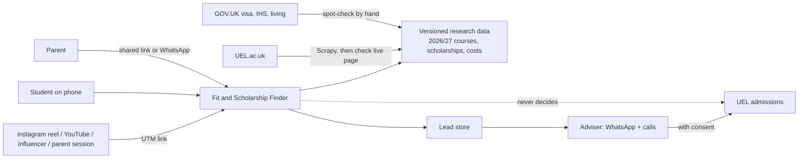
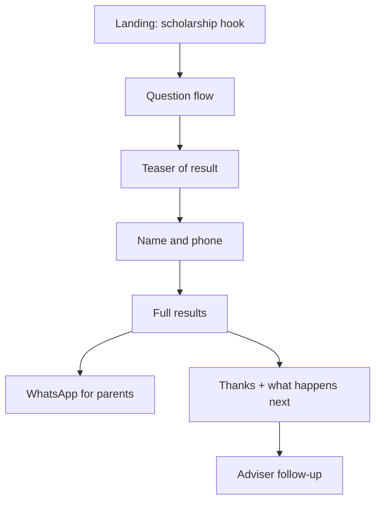
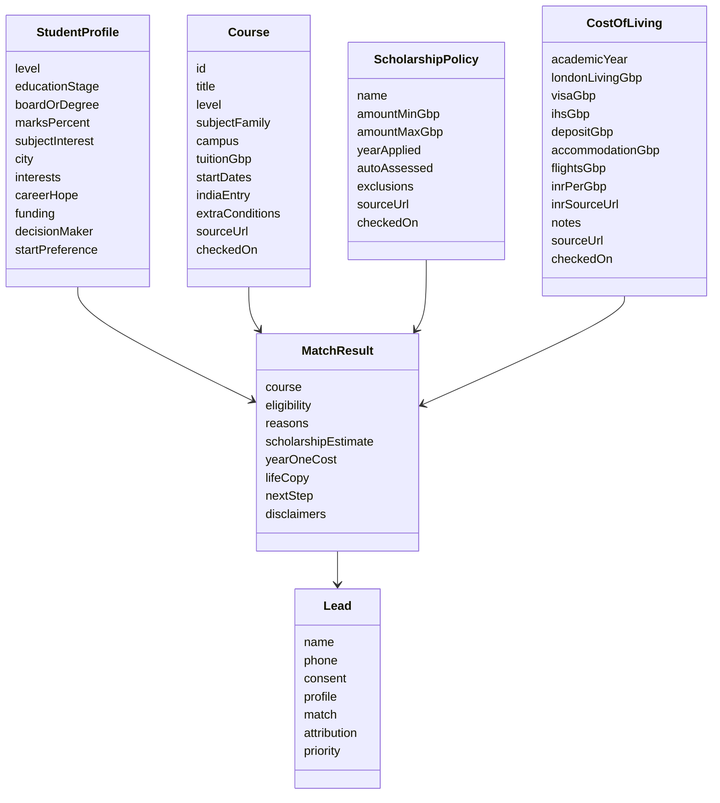
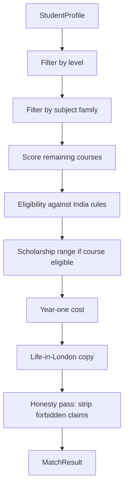
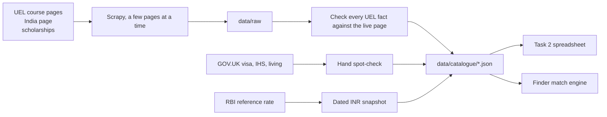

# Architecture: UEL Fit & Scholarship Finder

This document is the build plan for the Finder described in [`problemStatement.md`](./problemStatement.md). It is written so the six assessment tasks become one product, not six separate exercises. The university and its public website are real; everything else is a mock.

The Finder is not a course search. It has one job: take an Indian student who has just tapped through from an Instagram reel, and move them from “just looking” to wanting to apply. It does that with three outputs on one results page:

1. **A course match** — which UEL course suits them, and whether they appear to meet entry requirements.
2. **A scholarship and first-year cost** — honest, early, and the reason they start and finish.
3. **A picture of their life in London** — built from their own answers, so they can see themselves there.

Only UEL can decide a place, a scholarship amount, a visa, or a job. The architecture treats that as a hard product rule, not a footnote.

---

## 1. What we are building

### 1.1 Product in one sentence

A phone-first questionnaire that matches an Indian student to a UEL course, estimates first-year cost after a possible international scholarship, writes a personal “life in London” result, and captures a lead so an adviser can follow up on WhatsApp.

### 1.2 What we are not building

- A searchable course catalogue.
- An application form for UEL.
- A guaranteed offer, scholarship calculator that pretends to be official, visa checker, or job-outcome predictor.
- A logged-in student portal.
- A live scrape of UEL on every request. Research is collected, checked, dated, and stored as versioned data.

### 1.3 Two delivery layers

The assessment asks for a small working prototype (task 5) and written work that describes the full tool (tasks 1, 3, 4, 6). The architecture is therefore two concentric products that share the same domain:

| Layer | Scope | Why it exists |
| --- | --- | --- |
| **Full product** | Complete question set, 15+ courses, parent share, adviser routing, attribution, edge-case handling | Tasks 1–4 and 6. This is the system we design. |
| **Prototype** | 5–6 questions, one results page, lead capture, live phone link | Task 5. This is the system we ship first. It uses the same matching, cost, and honesty rules as the full product. |

The prototype is a vertical slice through the full architecture, not a throwaway demo.

---

## 2. Design principles

These constraints come straight from the brief and drive every technical choice.

1. **Phone first, reel next.** Most students open this on a phone immediately after a short Instagram reel. They know little about UEL. First paint must be fast, one-thumb, and make the scholarship visible without a wall of university copy. No “limited seats,” countdowns, or fake urgency — that is how this student smells a scam and closes it.
2. **Scholarship is the hook; life in London is the want; the course match is the confidence.** Screen order, copy, and layout follow that sequence. He shows his father only if the result looks like he could get in. The father says apply only if a scholarship makes the fee feel possible.
3. **Parents are part of the product.** He decides; they must agree to pay. Funding is often “we don’t know yet.” The tool must produce something he can put on the dining table: eligibility he is willing to show, and a first-year cost the mother will not kill on sight.
4. **Honesty is a system, not a disclaimer.** The Finder never promises a place, a scholarship amount, a visa, or a job. Families will look for placement rates; we do not invent them. Forbidden claims are blocked in copy templates and in the matching engine, not only in a footer.
5. **Data outlives the UI.** Academic year for this build is **2026/27**. Courses, fees, dates, and scholarships will change for years. Facts live in versioned files with a source URL and a checked-on date. Missing facts are placeholders, never invented numbers.
6. **Capture value before capture contact.** Name and phone come after the student has a reason to give them: a preview of the result, not a cold form on screen one. Trust is “it used my answers and felt written for me.”
7. **One tool, six tasks.** Personas, research, questions, results copy, prototype, and edge-case judgement all read from the same domain model.

---

## 3. Users and what they need from the system

| Actor | Question they arrive with | What the system must give them | What we need from them |
| --- | --- | --- | --- |
| **Student (bachelor’s or master’s)** | Would I get in, can I afford it, what would it lead to? | A plausible course, an eligibility signal, a cost picture, a life-in-London story, a next step | Answers, then name and phone to unlock the full result |
| **Parent** | Is it worth the money, will my child be safe and looked after? | A shareable summary: cost, scholarship range, campus, support, honest caveats | Nothing required. They open a link or a WhatsApp forward |
| **Adviser (our team)** | Who is likely to apply, or needs to apply soon? | A lead record with answers, match, score, and a call-priority rank | They call; they do not use the student UI |
| **UEL** | More good students who apply without an agent | Consenting leads, with enough context to continue the conversation | They decide the place and the scholarship |

The commercial reason this exists: many Indian students apply through paid agents. UEL often pays £2,000 or more per student. A Finder lead that applies directly is a student UEL does not pay an agent for. That is why attribution (which video or influencer brought them) and lead quality matter.

### 3.1 Primary persona (Task 1) vs results fixtures (Task 4)

Task 1 is one family. Task 4 is two other people the brief already named. Same tool.

**Task 1 — design around him**

Mumbai. Finished engineering in India, above average. Fun, football and cricket, good at friends. Wants a **one-year business master’s** because London is a hub and the fees feel reasonable. Father: MNC 9–5, sole earner. Mother: housewife. Month-to-month, almost no savings, eat out once a week. He goes only if they agree to pay. They do not know how they would pay.

| | He wants | They want | They fear |
| --- | --- | --- | --- |
| **Boy** | Good job, work–life balance, travel | — | No job, back in Mumbai |
| **Father** | — | Bigger house, a car they could never buy | Debt |
| **Mother** | — | Same jump in living standard | Fees too high → she says no |

Real competitor: a **good job in India** that can carry the family’s monthly expenses *and* leave savings — not a more famous UK university.

How he moves:

1. Arrives from an **Instagram reel**.
2. Stays if the result feels **personal** (his answers came back as a life, not a brochure).
3. Leaves if it looks like a **“limited seats” scam**.
4. **Shows his father** only if he **appears to meet** the published requirements.
5. Father says apply if a **scholarship** makes year one feel possible. They will look for placements; we still do not promise a job.

**Task 4 — write these two results pages**

- **Student A:** Hyderabad, finished Class 12 CBSE 82%, computing, football, loan arranged, wants to work in the UK.
- **Student B:** Kochi, 17, still Class 12 CBSE ~75%, business, food and cooking, whole family decides, worried about cost.

Copy slots must cover cricket and football, food, Mumbai / Hyderabad / Kochi, unknown funding, loan, family-as-decider, and “he decides if they pay.”

---

## 4. System context



The Finder reads research data. It does not call UEL’s site at runtime. It does not issue offers. UEL remains the only decision-maker.

---

## 5. Student journey

The emotional arc the brief asks for: start because of cost, stay because the questions feel personal, finish because they can see themselves in London, apply because the next step is small and honest.



### 5.1 Landing

- One headline, one subline, one button.
- Headline sells the scholarship without promising an amount. Example shape: “See what a UEL scholarship could mean for your first year in London.”
- Subline tells them it takes a few questions on their phone.
- Never “limited seats,” “apply in the next 2 hours,” or a countdown. That is Q16: he closes it.
- Capture UTM and influencer IDs here. Default assumption: Instagram reel. Do not ask the student which video they watched unless the link is missing them.

### 5.2 Question flow

Questions are grouped into short screens. One primary question per screen on a phone. Back is always available. Progress is visible but light.

Recommended full-product groups:

| Screen group | Purpose | What it changes |
| --- | --- | --- |
| **Level** | Bachelor’s or master’s | Course pool, entry rules, duration, cost shape |
| **Stage** | Still in Class 12, finished school, already a graduate | Eligibility, start date, “too early for a master’s” handling |
| **Subject** | What they want to study | Course match |
| **Marks and board / degree** | CBSE, state board, bachelor’s, percentage | Appears-to-meet vs does-not-appear-to-meet |
| **Life** | City, what they love (football, cricket, food, other), where they hope the degree leads | Personal results copy |
| **Money and family** | Loan / family / **don’t know yet**; who decides (including “I will if my parents agree to pay”) | Cost framing, parent WhatsApp, adviser priority |
| **Gate** | Name, phone, consent | Unlocks full results; creates the lead |

Prototype uses five or six questions from this set. See [section 14](#14-prototype-slice-task-5).

### 5.3 Why the gate sits after a teaser

Asking for a phone number on screen one will lose students who just watched a 30-second video. Asking after they have already invested answers, and after they have seen that a result exists, is the honest trade: their details for the full picture. The teaser can show the course name and that a scholarship *may* apply. The full cost breakdown, the life-in-London copy, and the parent message sit behind the gate.

### 5.4 Results

The results page is the product. Layout, in this order:

1. **Headline** written for that student, not “Your results”.
2. **Course + eligibility signal.**
3. **Scholarship range and first-year cost estimate.**
4. **Centre of the page: life in London**, built from their answers.
5. **Next step and button.**
6. **Honesty line** always visible: UEL decides the place and the scholarship; this is not an offer.

Keep the student-facing page under 300 words. A parent WhatsApp sits under 120 words.

### 5.5 After submit

A short confirmation: we will WhatsApp, an adviser may call, nothing has been sent to UEL until they agree. For the mock, this can be a static screen.

---

## 6. Domain model

All six tasks speak this language. If a fact cannot be placed in one of these objects, it does not belong in the product.



### 6.1 Course

Enough to match, cost, and cite. Not a CMS dump of the whole UEL page.

```ts
type CourseLevel = "undergraduate" | "postgraduate-taught";

type IndiaEntry = {
  qualification: "class-12" | "bachelor";
  boards?: string[];          // e.g. CBSE, ISC, Kerala state
  minPercent: number;         // overall, as published for India
  subjectConditions?: string[]; // e.g. Maths 50% in Year 12
  notes?: string;             // contradictions, caveats, placeholders
};

type Course = {
  id: string;
  title: string;
  level: CourseLevel;
  subjectFamily: "computing" | "business" | "engineering" | "health" | "media" | "law" | "other";
  campus: "Stratford" | "Docklands" | "University Square Stratford" | "unknown";
  durationYears: number;      // one-year master's is a selling point for the Task 1 student
  tuitionGbpYearOne: number | "PLACEHOLDER";
  startDates: string[];       // "2026-09" | "2027-01"
  indiaEntry: IndiaEntry;
  extraConditions: string[];
  scholarshipEligible: boolean;
  sourceUrl: string;
  checkedOn: string;          // ISO date
  issues?: string[];          // out of date, contradicts, not India-specific
};
```

Task 2 needs at least 15 courses. Catalogue is **management-heavy** (his master’s path) and still holds computing (Student A), engineering, and one or two other subjects. The prototype only has to *run* against the subset its 5–6 questions can reach (computing and business are enough to serve Students A and B). Exact titles follow what UEL publishes for **2026/27**.

Intended basket (swap names to match the live page):

| Group | Courses |
| --- | --- |
| Management UG | Business Management, Marketing, Accounting and Finance, International Business |
| Management PG | International Business, Marketing, MBA, plus one more management master’s UEL actually offers |
| Also | Computer Science UG, Computer Science or Data Science MSc, Civil Engineering, Mechanical Engineering, Law or Psychology |

### 6.2 Scholarship

UEL’s published international scholarship (as of research, confirm again at implementation):

- No separate application.
- Assessed automatically after a complete application and an offer.
- **£500 to £5,000** off **first-year** tuition.
- Amount depends on the course, at the university’s discretion.
- Not available for foundation, pre-masters, short courses, exchange, franchised programmes.

```ts
type ScholarshipPolicy = {
  id: "uel-international-scholarship";
  amountMinGbp: 500;
  amountMaxGbp: 5000;
  appliesTo: "first-year-tuition";
  autoAssessed: true;
  requiresOffer: true;
  eligibleLevels: CourseLevel[];
  exclusions: string[];
  sourceUrl: string;
  checkedOn: string;
};
```

The UI may show a **range**, a **worked example**, or “UEL will confirm this in an offer letter”. It must never show a single figure as *their* award.

### 6.3 First-year cost

Families ask “what would year one really cost?”, not only tuition. This build includes **every** line below. Academic year: **2026/27**.

```
yearOneCost ≈ tuition − scholarshipShown + londonLiving + visa + ihs + deposit + accommodation + flights
```

Where `scholarshipShown` is a clearly labelled **illustration** (for example the bottom, midpoint, or a range), never “you will get”.

| Line | Source |
| --- | --- |
| Tuition | UEL course page, 2026/27 |
| International scholarship | UEL international scholarships page — range, not their award |
| London living / maintenance | GOV.UK, spot-checked by hand |
| Student visa | GOV.UK, spot-checked by hand |
| Immigration Health Surcharge (IHS) | GOV.UK, spot-checked by hand |
| UEL tuition deposit | UEL, if published; else placeholder |
| Accommodation deposit / typical room | UEL or sourced housing page; else placeholder |
| Flights India → London | labelled estimate or placeholder — never a silent made-up fare |

GBP is the source of truth. Show a labelled **INR snapshot** using the **RBI reference** rate, with URL and date. Do not live-convert at request time.

If a figure is not found, show `PLACEHOLDER — confirm on GOV.UK / UEL` rather than a guessed number. The mother says no when fees look too high; a missing line is better than a fake low total.

### 6.4 Eligibility states

The engine never returns yes/no admission. It returns one of:

| Code | Student-facing meaning | Used when |
| --- | --- | --- |
| `appears_to_meet` | You appear to meet the published entry requirements for this course | Marks and qualification clear the India threshold and extra conditions |
| `below_requirement` | Your marks are below the published requirement. An adviser can talk through options | Marks under threshold |
| `wrong_level` | This level does not match where you are in your studies | Class 12 student who picked a master’s |
| `subject_gap` | Your background may not match this subject | e.g. B.Com → computing master’s, no computing modules on record |
| `too_early` | You can plan now; you apply when results / a degree are in | Still in Class 12, bachelor’s, expected marks |
| `unknown` | We do not have enough sourced data to judge | Missing research; show a placeholder |

---

## 7. Matching and scoring engine

A pure TypeScript module. No React, no fetch. Same function powers the prototype, the task 4 result pages, and the task 6 judgements.

```
match(profile, catalogue, policies) → MatchResult
```



### 7.1 Course selection

1. Keep courses whose `level` matches the student’s chosen level. If the student is still in Class 12 and chose master’s, do **not** silently switch them to a bachelor’s. Return `wrong_level` and a clear next step (see [section 15](#15-edge-cases-task-6)).
2. Keep courses in the chosen `subjectFamily`. If none, return the closest family with an explicit “we matched you to the nearest subject we have sourced”.
3. Score remaining courses:
   - subject exactness
   - start date vs their preference
   - eligibility fit
   - scholarship eligibility
4. Pick **one** primary course. The Finder sells a future, not a shortlist. A second “also look at” course is allowed only if it does not dilute the page.

### 7.2 Eligibility

Compare `profile.marksPercent` and `profile.boardOrDegree` to `course.indiaEntry`.

- Use the India-specific rules from UEL’s country page, not a generic UK tariff, unless a course page states something stricter. If they conflict, record both in `issues` and show the stricter one with a note.
- Expected marks (still in Class 12) produce `too_early` plus a provisional reading: “If you achieve around 75%, you would be below / around / above the published 60% CBSE guide.”
- Extra conditions (Maths, portfolio, work experience) are checked if we asked for them; otherwise they appear as “this course also asks for X — an adviser will check”.

### 7.3 Scholarship estimate

If the matched course is scholarship-eligible:

- Show **£500–£5,000 off first-year tuition**.
- Say it is assessed automatically after a complete application, and only appears in an offer letter.
- Do not pick a number from marks. Marks are not how this scholarship is described.
- Optional illustration: “If UEL awarded £2,000, year-one tuition would be £X.” Labelled as an example.

If the course is in the exclusion list, say so plainly.

### 7.4 Year-one cost

Present as a small stack, not a single mysterious total:

| Line | Source |
| --- | --- |
| Tuition | Course record, 2026/27 |
| International scholarship | Range, not a deduction unless labelled example |
| Living in London | GOV.UK, dated, hand-checked |
| Student visa | GOV.UK, dated, hand-checked |
| IHS | GOV.UK, dated, hand-checked |
| Tuition deposit | UEL, or placeholder |
| Accommodation | UEL / sourced, or placeholder |
| Flights | labelled estimate or placeholder |

Show GBP as the source of truth. Always show a labelled **INR snapshot** from the **RBI reference** rate (URL + date). Not live FX.

---

## 8. Copy and personalization

The centre of the results page is not a template with a name swapped in. It is a short piece of writing assembled from the student’s answers, then passed through the honesty filter.

### 8.1 Slot model

```ts
type LifeSlots = {
  city?: string;              // Mumbai, Hyderabad, Kochi, ...
  interest: "football" | "cricket" | "food" | "other";
  level: CourseLevel;
  subjectFamily: string;
  careerHope?: "work-in-uk" | "return-home" | "travel" | "balance" | "undecided";
  funding?: "loan" | "family" | "unsure";   // "unsure" is the Task 1 default
  decisionMaker?: "self" | "family" | "self-if-parents-pay";
};
```

Each slot maps to a **sourced, pre-written fragment** (Docklands and football or cricket; East London food; weekend markets; Indian student community; campus-to-city). Fragments are editorial, not generated at request time in the prototype. That keeps tone consistent and stops the model inventing clubs, salaries, visas, or placement rates. Personalisation is how this student decides the tool is real.

A later full product may use an LLM to stitch fragments, but the fragments themselves stay human-written and claim-checked.

### 8.2 Honesty pass

A final function `assertHonest(copy: string): string` (or a test that fails the build) rejects or rewrites:

| Forbidden | Allowed |
| --- | --- |
| “You have a place” / “you are in” | “You appear to meet the published requirements” |
| “You will get £3,000” | “International scholarships are typically £500–£5,000, decided by UEL” |
| “You will get a visa” | “You would apply for a student visa if UEL makes an offer” |
| “You will get a UK job / PR” / invented placement % | “Some graduates look for work in the UK; that is not guaranteed” |
| “Limited seats” / fake countdown | Nothing. No urgency theatre. |
| Invented fees, clubs, or names | Placeholders or sourced facts |

Task 4’s Student A and Student B pages are fixtures: they must be reproducible by running `match()` on those two profiles.

---

## 9. Lead, consent, attribution, adviser routing

### 9.1 Lead record

```ts
type Lead = {
  id: string;
  createdAt: string;
  name: string;
  phone: string;              // E.164, India default +91
  consentWhatsapp: boolean;
  consentShareWithUel: boolean;
  profile: StudentProfile;
  match: MatchResult;
  attribution: {
    utmSource?: string;
    utmMedium?: string;
    utmCampaign?: string;
    influencerId?: string;
    landingPath: string;
    referrer?: string;
  };
  priority: 1 | 2 | 3;
  priorityReasons: string[];
};
```

### 9.2 Why attribution is worth knowing

The brief asks how we tell which video or influencer brought the student, and why that matters.

- **Links, not a quiz question.** Every reel description and influencer bio uses `?utm_source=instagram&utm_campaign=reel-april&utm_content=creator-priya`. The landing page stores these on first load. Primary channel for this build: Instagram reels.
- **Why it matters:** which creative actually produces students who finish the Finder and take an adviser call; which creators bring browsers only; which campaigns UEL should keep paying. That is how this tool competes with the £2,000 agent commission.

### 9.3 Who gets a call first

A deterministic score, visible to the adviser, never to the student.

Higher priority when:

- They appear to meet requirements.
- They chose a start date within ~6 months.
- They have a loan arranged, or the family is the decision-maker and they asked for a parent summary (intent is real).
- They requested a call / WhatsApp.
- They are below the requirement but close, and still in Class 12 (time to improve or pick a foundation path).

Lower priority when:

- Wrong level and they bounced.
- Far below requirements with no path we can honestly offer.
- No consent.

Prototype can store leads in memory or a JSON file. Full product would use a small database and a private adviser view. Mock UEL handoff is a “export this lead” record, not a real integration.

---

## 10. Parent involvement

Parents are a first-class journey, not a PDF export.

1. **During the questions:** ask who will decide (including “I will, if my parents agree to pay”), and whether cost is the family’s main worry. That changes results tone (more cost and safety for family-decision students such as Student B; a “show your father” CTA for the Task 1 student).
2. **On results:** a “Forward this to your parents” WhatsApp message, under 120 words, in plain language: course, eligibility signal, scholarship *range*, year-one picture, what happens next, what is not promised.
3. **Parent link:** `/p/[leadId]` or a query flag `?view=parent`. Same facts, calmer layout, more on cost, accommodation, and support, less on “your weekends”. Task 6’s parent case uses this view.
4. **Do not** require the parent to repeat the questionnaire.

---

## 11. Data and research pipeline (task 2)

Runtime never scrapes. Research is a separate, polite, dated pipeline that produces the catalogue the app reads.



Locked protocol:

- **Scrapy first** on UEL course pages. Then **every UEL fact is checked against the live page**.
- **GOV.UK** visa, IHS, and living costs are **spot-checked by hand** (his Task 2 job).
- INR from the **RBI reference** rate, URL and date stored with the snapshot.
- Scrape politely and anonymously: a few pages at a time, obey `robots.txt`, never log in.
- Every fact has a URL and a date. Academic year **2026/27**.
- Record what is out of date, contradictory, or not about students from India. None known at kickoff.
- Scrapers collect wrong information as happily as correct information. The human check is part of the architecture.

Suggested files:

```
data/
  raw/                     # optional scraper output
  catalogue/
    courses.json
    scholarships.json
    costs.json
    sources.csv            # url, field, value, checkedOn, collector, issues
  copy/
    life-fragments.json
    results-a.md           # fixture for Student A
    results-b.md           # fixture for Student B
    whatsapp-b.md
```

The spreadsheet submitted for task 2 is a view of `sources.csv` plus a short note: Scrapy on UEL, live-page check on every UEL fact, hand spot-check on GOV.UK visa / IHS / living, RBI for INR.

---

## 12. Application architecture

Chosen so a phone-first prototype can go live quickly, while the domain stays testable and the data can be updated for years.

### 12.1 Stack

| Piece | Choice | Reason |
| --- | --- | --- |
| App | Next.js (App Router) + TypeScript | One repo, easy live URL, server or static as needed |
| UI | Tailwind, mobile-first, 390px as the default canvas | Students are on phones |
| Domain | `src/domain/*` pure functions | Tasks 4 and 6 can be unit-tested without a browser |
| Data | JSON in `data/catalogue` | Fees and dates change without a rewrite |
| Hosting | Vercel (or equivalent) | Live link for task 5 |
| Leads (prototype) | Route handler writing to a store, or a form endpoint | Enough to show “what they see after” |
| Analytics | UTM parse + privacy-light page events | Attribution without a marketing suite |

No auth for students. No UEL API. No real WhatsApp Business API in the mock — the “WhatsApp message” is copy the student can send.

### 12.2 Logical modules

```
src/
  app/
    page.tsx                 # landing
    find/                    # question wizard
    results/                 # full results (gated)
    thanks/                  # post-gate confirmation
    p/[id]/                  # parent view
    api/leads/               # accept name, phone, consent
  domain/
    types.ts
    match.ts                 # course + eligibility
    scholarship.ts
    cost.ts
    copy.ts                  # life in London + WhatsApp
    honesty.ts               # forbidden-claim checks
    priority.ts              # adviser ranking
  data/                      # typed loaders over JSON
  components/
    screens/                 # one component per wizard screen
    results/
    layout/                  # phone shell, progress, CTA
```

UI components do not compute eligibility. They call `match()` and render `MatchResult`.

### 12.3 State

- Wizard state lives in memory, mirrored to `sessionStorage` so a refresh on a phone does not wipe five answers.
- Attribution is written once on first landing, into the same session.
- After the gate, a `leadId` is created. Results load from that lead, so a parent link can reopen the same facts.
- No global student account.

### 12.4 Rendering

Landing, questions, and confirmation are static or server-rendered for fast first paint. Matching runs on the client in the prototype (catalogue is small). The honesty tests run in CI against copy fixtures.

---

## 13. Screen architecture (full product)

Phone shell: one column, large tap targets, primary button pinned to the bottom, back in the header, progress as a thin bar.

| # | Screen | Content | Primary action |
| --- | --- | --- | --- |
| 0 | Landing | Scholarship-led headline, 10-second promise, honesty half-line. No limited-seats copy. | Start |
| 1 | Level | Bachelor’s / master’s | Continue |
| 2 | Stage | Still in Class 12 / finished school / graduate | Continue |
| 3 | Subject | Short list of subject families, not 200 courses. Management is first-class, not buried. | Continue |
| 4 | Marks | Percentage + board or degree. Conditional on stage | Continue |
| 5 | Life | What they love (football, cricket, food, other); optional city and career hope | Continue |
| 6 | Money and family | Loan / family / **don’t know yet**; who decides, including “I will if my parents agree to pay” | See my result |
| 7 | Teaser | Course name + “scholarship may apply” | Unlock full result |
| 8 | Gate | Name, Indian phone, WhatsApp consent, UEL-share consent | Show my result |
| 9 | Results | Headline, course, cost, life, next step | WhatsApp parents / talk to an adviser |
| 10 | Thanks | What we will do, what we will not promise | Done |

Conditional questions (task 3): master’s-only degree class; Class 12-only board; computing-only Maths condition if we have sourced it. Anyone else never sees them.

---

## 14. Prototype slice (task 5)

A live link that works on a phone. Judged on use, not code. It must still be the same product.

**In scope**

- 5–6 questions from the full set, enough to distinguish Student A from Student B and to drive eligibility, scholarship, and cost.
- Matching against real sourced courses (computing and business at minimum).
- Scholarship range + first-year cost from task 2 data.
- One of the task 4 results pages (Student A is the richer “I can see myself there” page; Student B is the better parent-share demo — pick one as the default path, keep the other as a fixture).
- Gate screen and the “what they see after” confirmation.

**Suggested six questions**

1. Bachelor’s or master’s?
2. Still in Class 12, finished school, or already a graduate?
3. Computing, business / management, or another subject?
4. Marks (achieved or expected) and board / degree.
5. What do you love outside class? (football, cricket, food and cooking, other)
6. Who helps decide, and is cost the big worry? (I will if my parents agree / the family decides / loan / we don’t know how we’d pay yet)

**Out of scope for the prototype, still designed above**

- All 15 courses in the UI.
- Real WhatsApp sending.
- Adviser dashboard.
- Live INR FX (dated RBI snapshot is in scope; live conversion is not).
- LLM copy generation.
- Placement statistics.

**Acceptance**

- Opens on a phone without pinch-zoom.
- Completes in a few minutes.
- Never uses the four forbidden promises.
- Student A’s answers produce Student A’s result shape; edge cases in section 15 do not crash or lie.

---

## 15. Edge cases (task 6)

These are product rules implemented in `match.ts`, then described in the written judgement.

| Person | What they should see | Is that right? |
| --- | --- | --- |
| **Class 12 student who chooses a master’s** | Do not match a master’s course. Explain that a master’s needs a bachelor’s. Offer to show bachelor’s options in the same subject, without pretending they selected them. | Yes. Silent remapping would mislead. |
| **Marks below the entry requirement** | Still show a course, with `below_requirement`, the published threshold, and a next step (adviser, retake, foundation if sourced). Still show scholarship as a *possibility if they later receive an offer*, not as compensation for low marks. | Yes. Honesty plus a path is better than a dead end or a fake pass. |
| **B.Com graduate wanting a master’s in computing** | `subject_gap`. Do not say they meet computing entry. If UEL publishes a conversion / pre-masters / specific computing master’s that accepts a business degree, show that with sources. Otherwise: adviser conversation, not a pretend match. | Yes. Subject fit is part of “would I get in”. |
| **Parent who opens a link their child sent** | Parent view: cost stack, scholarship range, campus, support, eligibility in plain language, no “your weekends playing football” unless the child chose to include it. No extra form. Same caveats. | Yes. The parent is deciding with money and safety, not browsing courses. |

---

## 16. Honesty and claims as architecture

Implement this as a checklist in code and in copy review, because the brief will mark any promise UEL did not make.

**Never state as fact**

- A place at UEL.
- A specific scholarship amount for this student.
- A visa outcome.
- A job, salary, placement rate, or right to stay in the UK.

**Always state**

- Requirements are *published* requirements; admissions decide.
- Scholarship is typically £500–£5,000, course-dependent, automatic *consideration* after a complete application, confirmed in an offer letter.
- Costs are estimates for a named academic year, with source dates.
- Missing data is a placeholder.

Visual rule: the honesty line is close to the scholarship number, not buried at the footer of a long page. No urgency theatre anywhere on the path.

---

## 17. Non-functional requirements

| Concern | Target |
| --- | --- |
| Device | Usable on a mid-range Android phone, portrait, one hand |
| Speed | Landing interactive quickly on a 4G connection; catalogue is local JSON |
| Language | Clear English; short sentences; no UK-admissions jargon without a gloss |
| Accessibility | Large targets, readable contrast, visible focus, labels on every control |
| Privacy | Name and phone only after consent; no unnecessary personal data; mock store is not public |
| Longevity | Change a fee or scholarship by editing JSON and the source date, not by rewriting screens |
| Attribution | Survive the session from video tap to lead submit |

---

## 18. How the six tasks map onto this architecture

| Task | Architectural home | Output |
| --- | --- | --- |
| **1. Understanding the student** | Section 3.1 persona; copy slots, question order, parent view | 1–2 pages he writes; fact sheet is in `problemStatement.md` |
| **2. Research** | `data/catalogue` + `sources.csv`; Scrapy + live check + GOV.UK spot-check | Spreadsheet with URL and date on every fact; GBP + RBI INR |
| **3. The questions** | Screen table in section 13 + conditional rules in the wizard | Exact wording, formats, options, why each question exists |
| **4. The results page** | `copy.ts` + fixtures for A and B | Exact on-screen words, WhatsApp for B, notes on why it works |
| **5. The prototype** | Next.js vertical slice in section 14 | Live phone link |
| **6. Judgement** | `match.ts` eligibility states in section 15 | What each person sees, and whether that is right |

If task 4 copy cannot be produced by the engine in task 5, the architecture has split. Keep them on the same `match()` function.

---

## 19. Build order

1. **Domain types and empty catalogue** — so research has a schema to fill. *(Task 1 facts are locked.)*
2. **Task 2 research** — 15+ management-heavy courses for 2026/27, scholarship policy, full first-year cost stack, RBI INR snapshot, all sourced and dated.
3. **`match()`, `scholarship()`, `cost()`, `honesty()` with tests** — including the four task 6 cases, Students A and B, and the Task 1 path (engineering graduate → business master’s, funding unknown).
4. **Task 3 question spec** — freeze wording before building screens.
5. **Prototype UI** — landing → six questions → teaser → gate → one results page → thanks. No limited-seats copy.
6. **Task 4 fixtures** — lock the exact results copy to the engine output, then write the “why it works” notes.
7. **Task 6 writing** — they now describe a tool that actually exists. Task 1 page remains his to write from the fact sheet.
8. **Deploy the live link** and a short note of AI tools used.

---

## 20. Submission shape

The architecture exists to produce the four things the brief asks to send to team@edin.world:

1. One document: tasks 1, 3, 4, 6.
2. One spreadsheet: task 2, with sources and dates, plus how it was collected.
3. One live prototype link.
4. One short note: which AI tools were used, and on what.

Until those four exist, the Finder is not done. This file is the map, not the submission.
