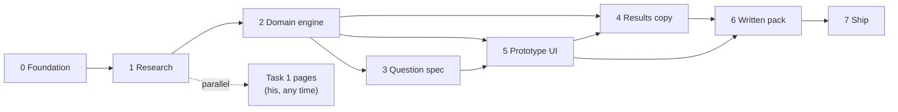

# Implementation plan: UEL Fit & Scholarship Finder

Phase-wise build plan for the product in [`architecture.md`](./architecture.md), against the brief and locked decisions in [`problemStatement.md`](./problemStatement.md).

Task 1 facts are locked. The next thing that unblocks everything else is research. The prototype is a vertical slice of the same engine that powers the written results and the edge-case judgements — not a separate demo.

---

## Who does what

| Person | Owns |
| --- | --- |
| **Ambrosh** | Task 1 written pages (1–2 pages, as people). GOV.UK spot-check: visa, IHS, living costs. Final read of the submission document. |
| **Build (this repo)** | Scrapy + UEL live-page check. Catalogue, engine, prototype, Task 3/4/6 drafts, deploy, AI-tools note. |

He does not need to wait for Phase 7 to write Task 1. The fact sheet is already in `problemStatement.md`.

---

## Hard rules that apply in every phase

- Academic year **2026/27**.
- Never promise a place, a scholarship amount, a visa, a job, a salary, or a placement rate.
- Never “limited seats,” countdowns, or fake urgency.
- Missing fact → `PLACEHOLDER` + source to confirm. Never invent a number.
- Every stored fact has a **URL** and a **checked-on date**.
- GBP is source of truth. INR is a labelled **RBI reference** snapshot, not live FX.
- Task 4 people stay **Student A (Hyderabad)** and **Student B (Kochi)**. The Mumbai graduate is who we design around, not who Task 4 is written for.

---

## Phase 0 — Foundation

**Goal.** An empty, typed repo the research can pour into.

**Depends on.** Architecture. Task 1 locked.

**Build**

- Next.js (App Router) + TypeScript + Tailwind, mobile-first.
- Folder skeleton from architecture §12.2: `src/domain`, `src/app`, `src/components`, `data/catalogue`, `data/raw`, `data/copy`.
- Domain types only: `Course`, `IndiaEntry`, `ScholarshipPolicy`, `CostOfLiving`, `StudentProfile`, `MatchResult`, `Lead`, `LifeSlots`.
- Empty JSON shells: `courses.json`, `scholarships.json`, `costs.json`, `sources.csv`.
- `honesty.ts` constants: forbidden phrases (`limited seats`, “you have a place”, “you will get £…”, job/visa/placement promises).
- README: how to run locally.

**Done when**

- `npm run dev` opens a blank phone-width shell.
- Types compile.
- Catalogue files exist and validate against the types (even if every value is empty / placeholder).

**Out of scope.** Scraping, UI questions, copy.

---

## Phase 1 — Research (Task 2)

**Goal.** The spreadsheet and the JSON the app will actually read.

**Depends on.** Phase 0 schema. Locked protocol in `problemStatement.md`.

### 1.1 Collect (UEL)

- Confirm `robots.txt`. Scrape politely: a few pages at a time, never log in, no personal account.
- Scrapy against UEL course pages for the locked basket (swap to the real published title if it differs):

  | Group | Target |
  | --- | --- |
  | Management UG | Business Management, Marketing, Accounting and Finance, International Business |
  | Management PG | International Business, Marketing, MBA, plus one more management master’s UEL actually offers |
  | Also | Computer Science UG, Computer Science or Data Science MSc, Civil Engineering, Mechanical Engineering, Law or Psychology |

- Also collect: [international scholarships](https://www.uel.ac.uk/study/fees-funding/international-fees-funding/international-scholarships), [India entry](https://www.uel.ac.uk/international/guidance-your-region/south-asia/india), campus and start dates, extra conditions.
- Write raw output to `data/raw/`.

### 1.2 Check every UEL fact

- Open the live page. Confirm fee, campus, dates, India requirements, extras.
- Record contradictions, out-of-date copy, and “not for India” in `issues`.
- Fill `data/catalogue/courses.json` and `scholarships.json`.
- Every row in `data/catalogue/sources.csv`: field, value, URL, checked-on, collector (`scrapy` / `live-check`), issues.

### 1.3 GOV.UK + RBI (split of work)

| Fact | Who |
| --- | --- |
| Student visa fee | **Ambrosh** spot-check |
| Immigration Health Surcharge | **Ambrosh** spot-check |
| London living / maintenance | **Ambrosh** spot-check |
| RBI INR reference rate | Build, URL + date |
| UEL deposit, typical room, flights | Build; placeholder if unsourced |

He pastes the three GOV.UK figures (value, URL, date). Build writes them into `costs.json` and `sources.csv`.

### 1.4 Spreadsheet

Export `sources.csv` to the Task 2 workbook. Cover sheet: how we collected it (Scrapy → live UEL check → his GOV.UK check → RBI).

**Done when**

- ≥15 courses, management-heavy, 2026/27, each with fee, campus, start dates, India entry, extras, URL, date.
- Scholarship policy stored as a **range**, auto-assessed, first-year only, with exclusions.
- Full first-year stack present or explicitly `PLACEHOLDER`.
- INR snapshot stored with RBI URL and date.
- Collection note written.

**Exit gate.** No engine work on unsourced numbers. If a course page is a mess, drop it and pick another UEL title in the same family.

---

## Phase 2 — Domain engine

**Goal.** One `match()` that can produce Task 4, Task 6, the Mumbai path, and the prototype.

**Depends on.** Phase 1 catalogue.

**Build**

| Module | Responsibility |
| --- | --- |
| `match.ts` | Filter by level and subject; pick one course; eligibility state |
| `scholarship.ts` | £500–£5,000 range if eligible; never a personal amount |
| `cost.ts` | Year-one stack in GBP + labelled INR |
| `copy.ts` | Life-in-London slots (football, cricket, food, city, funding, decider) |
| `honesty.ts` | Strip / fail forbidden claims |
| `priority.ts` | Adviser rank (not shown to the student) |

Eligibility states, exactly as architecture §6.4: `appears_to_meet`, `below_requirement`, `wrong_level`, `subject_gap`, `too_early`, `unknown`.

**Tests that must pass before UI**

| Profile | Expected |
| --- | --- |
| Student A — Hyderabad, Class 12 done, CBSE 82%, computing, football, loan, work in UK | Computing UG, `appears_to_meet` if 82% ≥ published India threshold, scholarship range, football life copy, loan framing |
| Student B — Kochi, still Class 12, ~75%, business, food, family decides, cost worry | Business UG, provisional / `too_early`, cost-first tone, parent WhatsApp slots |
| Mumbai graduate — engineering done, business master’s, funding unknown, self-if-parents-pay | One-year management PG, not silent-remap, cost stack a father can see |
| Class 12 + master’s | `wrong_level`, no fake master’s match |
| Marks below requirement | Course still shown, `below_requirement`, scholarship not used as consolation |
| B.Com → computing master’s | `subject_gap` |
| Honesty corpus | No job, visa, place, specific £ award, limited seats |

**Done when** `npm test` covers the table above. UI still does not exist.

---

## Phase 3 — Question spec (Task 3)

**Goal.** Freeze every question **word for word** before a screen is built.

**Depends on.** Phase 2 (so “why we ask it” can point at a real field). Persona in `problemStatement.md`.

**Write** `docs/questions.md` (or the Task 3 section of the submission doc):

For each question, in order:

- exact on-screen wording
- format (one option / several / dropdown / slider / typed)
- every option, word for word
- who sees it (everyone / master’s only / Class 12 only)
- why, and what it changes in `match()` / copy / cost / lead

Then the screen groups from architecture §13, plus:

- landing headline and button (scholarship hook, no limited seats)
- how the student should feel by results, and how order builds that
- where name and phone sit (after teaser), and why
- how parents get involved (`self-if-parents-pay`, Student B family, WhatsApp, parent view)
- where the tool could mislead, and the honesty pass
- what the adviser / UEL get, and call priority
- UTM on the Instagram reel link, and why attribution is worth knowing

**Prototype six (must be a subset of the full spec)**

1. Bachelor’s or master’s?
2. Still in Class 12, finished school, or already a graduate?
3. Computing, business / management, or another subject?
4. Marks (achieved or expected) and board / degree.
5. What do you love outside class? (football, cricket, food and cooking, other)
6. Who helps decide, and is cost the big worry?

**Done when** a stranger could build the wizard from `docs/questions.md` alone. No screen uses wording that is not in that file.

**His review.** Read for tone. If a question sounds like an application form or a scam, rewrite before Phase 5.

---

## Phase 4 — Results copy (Task 4)

**Goal.** Exact on-screen words for Student A and Student B, generated from `match()`, then edited for voice.

**Depends on.** Phase 2 engine. Can overlap Phase 5; **lock copy after** the engine is stable so the prototype and the document do not drift.

**Build**

1. Run `match()` on Student A and Student B fixtures.
2. Write the pages in `data/copy/results-a.md` and `results-b.md` — exact words, **under 300 words** each:
   - headline
   - course + whether they appear to meet requirements
   - scholarship range + first-year cost (full stack, GBP + dated INR)
   - centre: life in London from *their* answers (football / food, not generic campus)
   - next step + button
   - honesty line next to the scholarship, not in a footer
3. WhatsApp for Student B in `data/copy/whatsapp-b.md`, **under 120 words**, forwardable to parents.
4. Under each piece: a short note on why it would work on that person, and why that order.
5. Run `honesty.ts` on all three files.

**Done when**

- A’s page makes a loan-ready, football-loving computing student want UEL without promising a UK job.
- B’s page and WhatsApp give a cost-worried family something to discuss, without promising a place or an amount.
- Regenerating from `match()` does not contradict the locked copy. If it does, change the engine or the copy — never keep two truths.

---

## Phase 5 — Prototype UI (Task 5)

**Goal.** A live phone link. Judged on use, not code.

**Depends on.** Phase 2 engine, Phase 3 wording. Phase 4 copy can land in parallel; the prototype ships **one** of the two results pages (A = life-in-London; B = parent-share). Default recommendation: **Student A’s page** in the happy path, B kept as a fixture / parent WhatsApp.

**Screens, in order**

| # | Screen | Notes |
| --- | --- | --- |
| 0 | Landing | Scholarship headline, one button, UTM capture. No limited seats. |
| 1–6 | Questions | Phase 3 wording. One question per screen. Back. Light progress. `sessionStorage`. |
| 7 | Teaser | Course name + scholarship *may* apply. Not the full cost stack. |
| 8 | Gate | Name, Indian phone, WhatsApp consent, UEL-share consent. |
| 9 | Results | The chosen Task 4 page, filled from `match()`. |
| 10 | Thanks | What we will do. What we will not promise. |

Also: parent view `/p/[id]` enough for Task 6, even if crude.

**Phone rules**

- Default canvas ~390px. Primary button pinned. Large targets.
- Completes in a few minutes.
- Attribution from the landing URL survives until lead submit.

**Lead.** Route handler or file store. Enough to show “what they see after.” Not a CRM.

**Done when** (verify on a phone, not only a desktop screenshot)

- Reel → landing → six answers → teaser → gate → result → thanks works end to end.
- Student A’s answers produce Student A’s result shape.
- Mumbai-style answers (graduate, business master’s, don’t-know-funding) do not crash and do not remap to a bachelor’s in silence.
- Task 6 inputs produce the architecture table, not a blank screen.
- Honesty pass: view-source / copy contains none of the forbidden claims.
- No pinch-zoom required; no desktop-only layout.

**Out of scope for this phase.** All 15 courses in the UI, real WhatsApp API, adviser dashboard, live FX, LLM copy, placement stats.

---

## Phase 6 — Written pack (Tasks 1, 3, 4, 6)

**Goal.** The single document the brief asks for.

**Depends on.** Phase 3 spec, Phase 4 copy, Phase 5 behaviour (so Task 6 describes a tool that exists).

| Section | Source | Owner |
| --- | --- | --- |
| Task 1 | Fact sheet → 1–2 pages as people | **Ambrosh** |
| Task 3 | `docs/questions.md` | Build drafts, he checks tone |
| Task 4 | `results-a.md`, `results-b.md`, `whatsapp-b.md` + why-it-works notes | Build drafts, he checks voice |
| Task 6 | Run the four people through the prototype / `match()`. Write what they see, and whether that is right | Build drafts |

Task 6 must answer, for each person, *what they would see* and *whether that is right* — not a new design.

**Done when** one document holds 1, 3, 4, and 6, and nothing in it contradicts the live prototype.

---

## Phase 7 — Ship

**Goal.** The four submission items.

**Depends on.** Phases 1 and 5–6.

1. **Document** — Tasks 1, 3, 4, 6.
2. **Spreadsheet** — Task 2, sources and dates, collection note.
3. **Live link** — Vercel (or equivalent), opens on a phone.
4. **AI-tools note** — which tools, on what (Scrapy setup, coding, copy drafts — be specific and honest).

Smoke-check the live URL on a phone after deploy (landing, one happy path, one Task 6 path). Confirm UTM still sticks.

**Done when** those four exist and can be sent to team@edin.world. Until then the Finder is not done.

---

## Phase map onto the six tasks

| Task | First appears | Locked in |
| --- | --- | --- |
| 1 Understanding | Already (fact sheet) | Phase 6 pages |
| 2 Research | Phase 1 | Phase 1 spreadsheet |
| 3 Questions | Phase 3 | Phase 6 document |
| 4 Results | Phase 4 | Phase 6 document |
| 5 Prototype | Phase 5 | Phase 7 live link |
| 6 Judgement | Phase 2 tests, Phase 5 behaviour | Phase 6 document |

---

## Suggested sequence in time

Do not start a phase before its exit gate unless noted.

| Order | Phase | Can overlap |
| --- | --- | --- |
| 1 | 0 Foundation | Task 1 writing |
| 2 | 1 Research | Task 1 writing; his GOV.UK check once URLs are listed |
| 3 | 2 Domain engine | — |
| 4 | 3 Question spec | — |
| 5 | 5 Prototype UI | 4 Results copy |
| 6 | 4 Results copy | after engine stable; lock before document |
| 7 | 6 Written pack | his Task 1 pages drop in here |
| 8 | 7 Ship | — |

If time is short: **0 → 1 → 2 → 3 (prototype six only) → 5 → 4 (one page) → 7**, then backfill full Task 3 and Task 6 prose. Do not skip honesty tests or the GOV.UK check.

---

## Risks to watch

| Risk | What we do |
| --- | --- |
| Scraper copies an old fee | Live-page check is the source of truth, not `data/raw` |
| UEL titles do not match our basket | Swap to the nearest published management / computing / engineering course; keep ≥15 |
| GOV.UK check lags | Catalogue ships with `PLACEHOLDER` on visa / IHS / living until he confirms |
| Task 4 copy drifts from the prototype | Same `match()`; fixtures regenerated before the document is frozen |
| “Attractive placements” pressure | Not in the product. Named in Task 1 as a family want; forbidden in the engine |
| Phone layout only tested on desktop | Phase 5 exit is a real phone pass |

---

## What “done” is

Not a finished architecture. Not a filled catalogue. All four of:

1. One document: tasks 1, 3, 4, 6.
2. One spreadsheet: task 2, sourced and dated, plus how it was collected.
3. One live prototype link that works on a phone.
4. One short note: which AI tools were used, and on what.

Phase 0 is the next build step. Phase 1 is the next one that needs his GOV.UK check.
